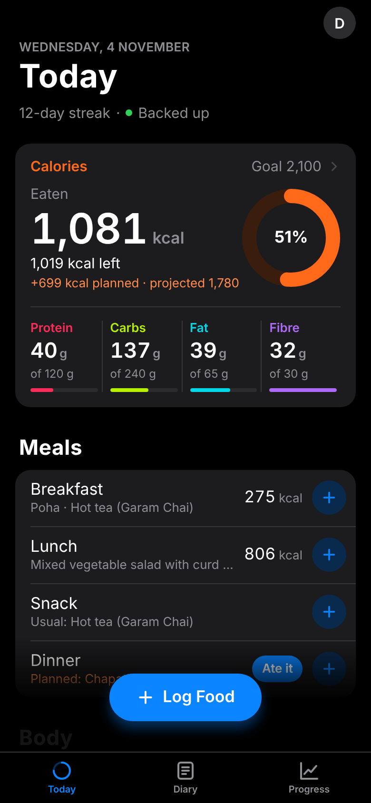
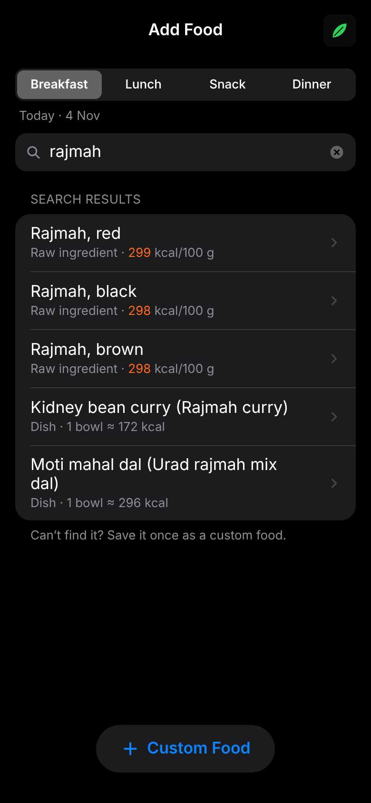
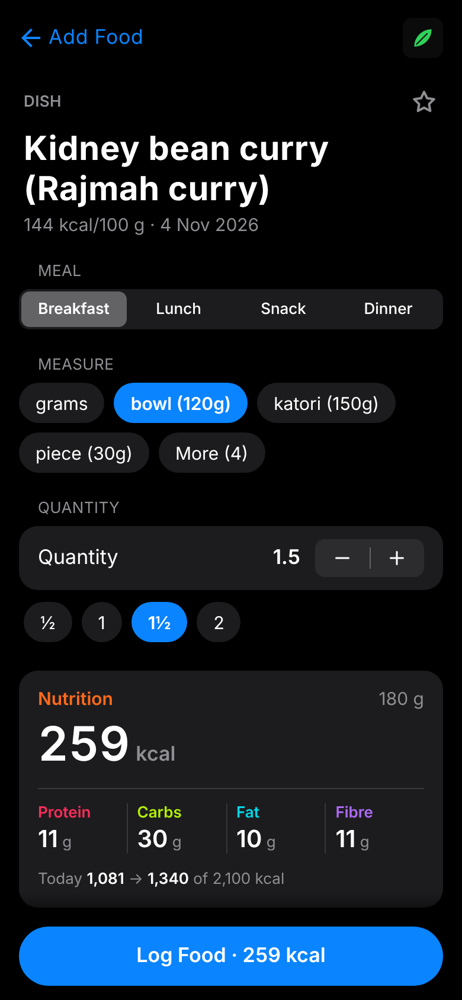
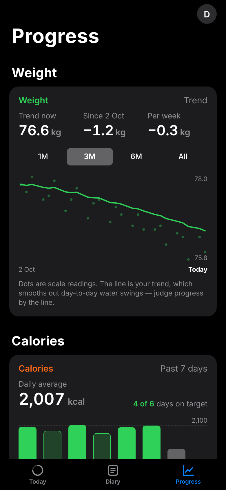

# Indian Nutrition Tracker

A calorie and macro tracker built for Indian food. It runs offline on India's food-composition
tables, makes logging a usual meal a one-tap job, and fills gaps in the database with an AI
lookup that cites its sources before anything is saved.

Expo (React Native) + TypeScript + SQLite · iOS, Android and web · built with Claude Code.

<p align="center">
  
  
  
  
</p>
<p align="center"><sub>Screenshots use a generated demo profile, not real user data.</sub></p>

## Why

Global trackers handle Indian eating poorly. They miss regional dishes, mis-estimate
ghee- and oil-heavy portions, and push you to log a dal or sabzi ingredient by ingredient.
On top of that, every calorie app has the same failure mode: logging takes too many taps,
so people stop. This app goes after both problems: Indian-native data, and a short path from
"I ate this" to "logged".

## What it does

- **Indian food database, offline.** 528 raw ingredients from IFCT 2017 (National Institute
  of Nutrition) and 1,014 cooked dishes from the Indian Nutrient Databank, bundled as SQLite
  with full-text search. Portions use household measures (bowl, katori, chapati, plate).
- **Fast logging.** Meal-aware recents, favourites, last-used portions, and one-tap
  "Log all" for a meal you eat often.
- **Plan vs. eaten.** Plan meals ahead and confirm them when you eat them. Planned food shows
  as a projection and never counts as intake.
- **Insights.** Today against your targets (calories, protein, carbs, fat, fibre), 7- and
  30-day averages, days on target, a logging streak, and a smoothed weight trend with waist
  readings.
- **AI lookup for missing foods.** For a dish the database doesn't have, a serverless function
  runs a web-search-grounded LLM, extracts per-100 g values through a strict JSON schema, checks
  that calories agree with the macros, and returns the cited sources. The user reviews and edits
  the values before saving.
- **Backup.** Sign-in with a one-way Supabase backup. The on-device database stays the
  source of truth for every read and write.

## Design decisions

- **One basis for all math.** Every value is `per100g × grams / 100`. Serving-size columns in
  the source data are inconsistent, so they're only used as a default suggestion.
- **Snapshots, not joins.** Calories and macros are computed once and stored on each log entry.
  History never changes when the food database changes, and insights read only those snapshots.
- **Only confirmed food counts.** A past plan that was never confirmed is not treated as eaten.
- **No adaptive TDEE.** Logged intake is usually under-reported, so an estimate built on it
  would come out too low. It was left out on purpose rather than shipped with a known bias.
- **Data fixes are explicit.** A source typo in one IFCT entry is corrected by a migration,
  with acceptance checks guarding it.

## Architecture

```
app/                 Expo Router screens (Today · Diary · Progress tabs, logging flow)
src/calc/            Pure, unit-tested math: targets, day totals, insights, weight trend
src/db/              SQLite access, migrations, search, Supabase backup outbox
api/lookup.ts        Vercel function: grounded AI nutrition lookup
db_build/            Builds assets/db/ifct2017.db from the IFCT and INDB source files
build_docs/          Milestone specs (M0–M7) the app was built against
supabase/            Backup schema migrations (row-level security per user)
```

On web, SQLite runs as WebAssembly (sql.js) and persists to IndexedDB. On iOS and Android it
uses expo-sqlite.

## Run it

```bash
npm install
```

```bash
npx expo start          # press w for web, or open in Expo Go
```

```bash
npm test                # unit tests
```

```bash
npm run verify:all      # milestone acceptance checks against the real database
```

The AI lookup needs `OPENAI_API_KEY` set on the Vercel deployment. The rest of the app works
without it.

## Data sources

- Longvah T. et al., *Indian Food Composition Tables 2017*, National Institute of Nutrition (ICMR).
- *Indian Nutrient Databank (INDB)*, Anuvaad Solutions, 2024.
